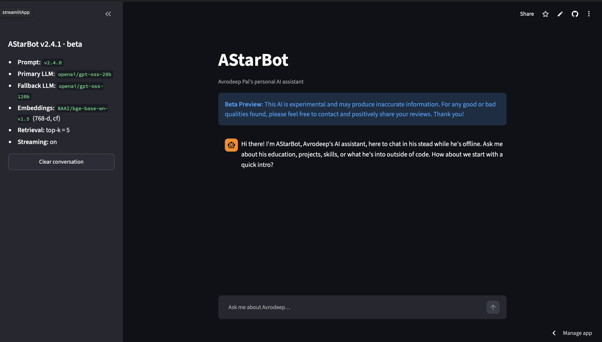

# AStarBot

**A grounded, bounded, stateless RAG assistant for a personal portfolio.**

AStarBot answers visitors' questions about Avrodeep Pal (education, work, projects, skills and interests) from a curated knowledge base. It is deliberately *not* a general chatbot. Every fact comes from retrieved context, anything out of scope is politely refused, and the server keeps no session state.


> Technical reference (snippets, configuration, test suite, Makefile targets, directory layout, deployment details): **[APPENDIX.md](APPENDIX.md)**.

---

## Why it exists

A portfolio chatbot has a narrow job, and most of the risk is in what it says *outside* that job: invented facts, private details, or a jailbroken persona. AStarBot is built around six principles:

| Principle | What it means here |
|---|---|
| **Grounded** | Answers come only from retrieved context. If it isn't in the knowledge base, the bot says so. |
| **Bounded** | Off-topic, private and unsafe questions get fixed, consistent refusals. |
| **Stateless** | No Redis, no database, no server sessions. The client carries the conversation. |
| **Deterministic** | No agents, no tool calling, no LangGraph. One fixed pipeline. |
| **Auditable** | A layered, versioned prompt and one JSON log line per event. |
| **Explicit** | Failures fall back through plain `try/except` paths that are visible in the code. |

---

## How it works

```
Client (React / Streamlit / CLI)          holds: recent_messages[], summary
        │  POST /chat  or  /chat/stream
        ▼
FastAPI (async)                           request id, CORS, strict schemas
        ▼
RAGEngine
   1. input guardrails       sanitise, cap lengths, whitelist roles
   2. regex injection screen
   3. follow-up rewrite      for the retrieval query only
   4. prompt-guard LLM   ┐   run concurrently
   5. retrieval          ┘   LRU cache → BGE embeddings → Pinecone → re-rank
   6. LLM chain              primary → fallback → static fallback (streamable)
   7. output guardrails      strip leaks, cap length (incremental when streaming)
   8. summarise              only when the client's window is full
        │
        ▼
{answer, updated_summary}  or  a plain-text token stream
```

- **Retrieval.** Each knowledge-base entry is a single vector, with no chunking. Query embeddings come from `BAAI/bge-base-en-v1.5`, served either by Cloudflare Workers AI or by a local sentence-transformers model. Pinecone over-fetches candidates, which are then re-ranked by cosine similarity plus an editorial priority.
- **Generation.** Groq serves a small primary model, a larger fallback and a prompt-guard classifier. If every tier fails, the user gets a fixed "technical snag" message, never a stack trace.
- **Memory.** The client keeps a short message window and a rolling summary written by the server. The server never stores either.
- **Safety.** Input is screened twice, first by a regex and then by a guard model. Output is sanitised so prompt markers or reasoning tags can't leak, even mid-stream.

---

## Tech stack

| Layer | Choice |
|---|---|
| Language | Python 3.11+ (3.12 in Docker and the devcontainer) |
| API | FastAPI + Uvicorn (one supervised, recycled worker) |
| Vector store | Pinecone serverless, 768-d, cosine |
| Embeddings | BGE-base-en-v1.5 via Cloudflare Workers AI, or local sentence-transformers |
| LLMs | Groq: `gpt-oss-20b` (primary), `gpt-oss-120b` (fallback), `llama-prompt-guard-2-86m` (guard) |
| Orchestration | `langchain-core` / `langchain-groq` (message types and the client only) |
| Config | `pydantic-settings`, environment variables or `.env` |
| UI | Streamlit beta client, terminal CLI, plus an external React portfolio frontend |
| Hosting | Render (API, Docker) and Streamlit Community Cloud (UI) |
| Tooling | pytest, ruff, Make, Docker, devcontainer |

---

## Quick start

```bash
git clone https://github.com/AvrodeepPal/AStarBot.git
cd AStarBot
cp .env.example .env     # add PINECONE_API_KEY, GROQ_API_KEY, CF_API_TOKEN, CF_ACCOUNT_ID

make dev                 # install everything (tests, UI, local embeddings)
make test                # offline test suite; no keys needed
make embed               # build the Pinecone index from data/*.json
make api                 # http://localhost:8000
make ui                  # Streamlit client on http://localhost:8501
```

For a lighter install with no torch, which needs Cloudflare credentials, run `make install` in place of `make dev`. The full list of targets is in the [appendix](APPENDIX.md#3-makefile-reference).

`make ui` starts the Streamlit client shown in **Figure 1**.

<p align="center">
  
</p>

<p align="center"><em>Figure 1: The AStarBot Streamlit client (v2.4.1 beta). The sidebar shows the live configuration reported by the API (prompt version, primary and fallback LLMs, BGE embeddings, top-k retrieval and streaming), and the chat pane opens with the bot's scoped greeting.</em></p>

---

## API at a glance

| Method | Path | Purpose |
|---|---|---|
| `POST` | `/chat` | Answer a question; returns `{answer, updated_summary}` |
| `POST` | `/chat/stream` | Same pipeline, streamed as `text/plain` |
| `POST` | `/summarize` | Fold a full client window into a fresh summary (for streaming clients) |
| `GET` | `/health` | Liveness check |
| `GET` | `/version` | App and prompt versions, models, embedding backend, client window policy |

```bash
curl -s localhost:8000/chat -H 'Content-Type: application/json' \
  -d '{"question": "What projects has he built?"}'
```

Requests are strictly validated (question ≤ 500 characters, ≤ 20 history messages), and every response carries an `X-Request-Id` header. Schemas and the client memory contract are documented in the [appendix](APPENDIX.md#5-api-reference).

---

## Project layout

```
AStarBot/
├── main.py            Uvicorn launcher (supervised single worker)
├── rag/               Core pipeline: config, guardrails, prompt, embedder,
│                      retriever, LLM chain, memory, orchestrator
├── interfaces/        FastAPI app, Streamlit client, CLI, shared window policy
├── scripts/           Index rebuild, score calibration, embedder parity check
├── data/              Knowledge base, one JSON file per topic
├── tests/             Offline unit and API tests
├── Dockerfile         Multi-stage image (slim by default)
├── Makefile           Every common command
└── APPENDIX.md        Technical reference
```

A file-by-file breakdown is in the [appendix](APPENDIX.md#2-directory-structure).

---

## Deployment

- **API on Render (Docker web service).** The default image is slim and has no torch, so it fits Render's 512 MB free instance using the Cloudflare embedding backend. It runs as a non-root user, has a `/health` healthcheck, and uses jemalloc to keep memory flat. Free instances spin down after 15 minutes idle, so both clients ping the API on page load to start the wake-up early.
- **UI on Streamlit Community Cloud.** The UI is a thin HTTP client that streams answers from the API and wakes a sleeping container in the background on page load.
- **Portfolio frontend.** Any origin listed in `FRONTEND_ORIGIN` can call the API directly.

Step-by-step settings are in the [appendix](APPENDIX.md#9-deployment).

---

## Testing

The suite runs fully offline. Pinecone, Groq, Cloudflare and the embedding model are all stubbed.

```bash
make test     # 163 tests
make lint     # ruff
```

It covers guardrails, prompt assembly, retrieval ranking and caching, embedder retries, streaming sanitisation, the concurrency of the guard and retrieval steps, and every API route. There is a per-file breakdown in the [appendix](APPENDIX.md#7-test-suite).

---

## What it intentionally does not do

No agents, tool calling, auth, server-side sessions, Redis, model-based reranking, chunking or fine-tuning. Complexity is earned, not assumed. Streaming, async execution and caching were added only after measurement showed they were needed.

---

## Author

Built by **Avrodeep Pal** · [GitHub](https://github.com/AvrodeepPal)

To ask about the person rather than the code, ask the bot.
